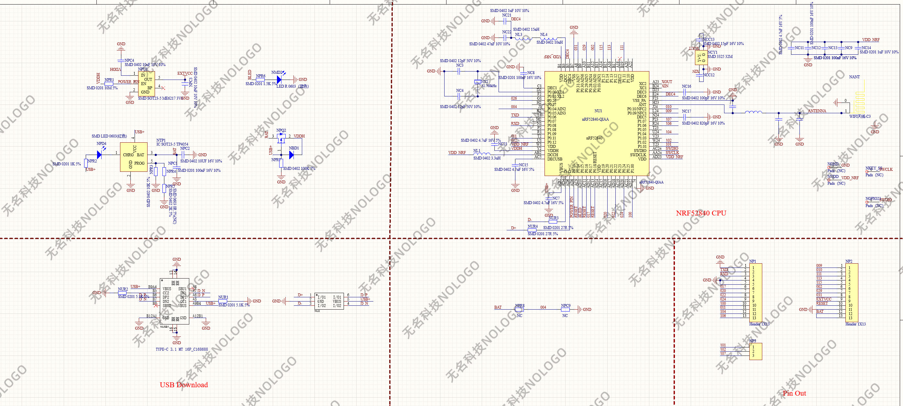

# LusoFW — montagem com nRF52840 e DX-LR30

Este guia documenta as variantes de repetidor e companion BLE para a placa
vermelha TENSTAR ROBOT ProMicro nRF52840 e o módulo DX-LR30 com SX1262.
Mantém o nome e a versão do firmware LusoFW existente.

Origem do software: [MeshCore](https://github.com/meshcore-dev/MeshCore) →
[fork LusoFW, Meshcore-Portugal/lusofw](https://github.com/Meshcore-Portugal/lusofw)
→ adaptações de hardware documentadas neste projeto. A versão do bootloader
é independente da versão do firmware LusoFW.

### Identificação visual da placa


A fotografia mostra as duas faces da placa usada como referência nesta
montagem. As inscrições junto aos pads permitem localizar os sinais da
tabela de ligações mais abaixo. Por exemplo, `100` corresponde a P1.00 e
`022` a P0.22; não são índices Arduino.

### Esquema elétrico da placa nRF52840

[](projectoGit/nfr52840.jpg)

Clica na imagem para abrir o esquema em tamanho completo. O ficheiro fornecido
mostra o regulador ME6217, o carregador da bateria, o circuito USB e as ligações
do nRF52840 aos conectores. A imagem tem a identificação NOLOGO e é usada como
referência para esta montagem; não é um esquema desenhado por este projeto.

Na cópia anotada fornecida anteriormente, o ramo de medição de bateria marcado
`004` é assinalado como um erro: a ligação real seria P0.24, que não é uma
entrada ADC. As resistências desse ramo estão indicadas como **NC** (não
montadas). Por isso, a implementação de medição deste projeto usa a entrada
interna **VDDH/5**, não esse divisor. A precisão da leitura continua em validação.

## 1. Atualização do bootloader

O bootloader permite carregar firmware antes de arrancar a aplicação.
Nesta montagem, o nice!nano de fábrica foi primeiro atualizado para nice!nano
0.9.2 e, depois, para ProMicro OTAFIX,
com o qual foram testadas atualizações por USB e por Bluetooth.
Não foram feitas alterações locais ao código do bootloader: foi instalado
um binário publicado pelo projeto
[oltaco/Adafruit_nRF52_Bootloader_OTAFIX](https://github.com/oltaco/Adafruit_nRF52_Bootloader_OTAFIX).

### Identificação antes e depois

| Campo | De fábrica | Primeira atualização | Segunda atualização |
| --- | --- | --- | --- |
| UF2 Bootloader | 0.6.0 | 0.9.2 | 0.9.2-OTAFIX2.2-BP1.3 |
| Model | nice!nano | nice!nano | ProMicro NRF52840 |
| Board-ID | nRF52840-nicenano | nRF52840-nicenano | nRF52840-promicro |
| Data de compilação | Jun 19 2021 | Jul 19 2024 | Apr 13 2026 |
| SoftDevice | S140 6.1.1 | S140 6.1.1 | S140 6.1.1 |

A placa chegou sem aplicação e entrava diretamente em modo DFU. Na primeira
atualização manteve o nome nice!nano; a identificação só mudou para ProMicro
na segunda atualização, ao instalar o OTAFIX.

Identificação original fornecida pelo utilizador:

```text
UF2 Bootloader 0.6.0 lib/nrfx (v2.0.0) lib/tinyusb (0.10.1-41-gdf0cda2d) lib/uf2 (remotes/origin/configupdate-9-gadbb8c7)
Model: nice!nano
Board-ID: nRF52840-nicenano
SoftDevice: S140 version 6.1.1
Date: Jun 19 2021
```

Esta sequência foi validada na placa identificada acima. O nome nice!nano
reportado pelo bootloader original não identifica, por si só, o hardware
de qualquer outra placa ou clone.

### Instalação por USB

A primeira atualização usou `update-nice_nano_bootloader-0.9.2_nosd.uf2`,
copiado para a unidade USB disponibilizada pelo bootloader. Após essa etapa,
a identificação era nice!nano 0.9.2, conforme a tabela acima.
Os passos seguintes descrevem a segunda atualização, de 0.9.2 para OTAFIX.

1. Usa um cabo USB de dados. Se houver falhas de reconhecimento, experimenta
   uma porta direta do computador; durante os testes houve suspeita de falhas
   intermitentes no hub USB, sem diagnóstico definitivo.
2. Faz duplo reset: dois contactos breves e rápidos entre **RST e GND**.
3. Abre a unidade USB e guarda a identificação de `INFO_UF2.TXT`.
4. Obtém o seguinte ficheiro na
   [release 0.9.2-OTAFIX2.2-BP1.3](https://github.com/oltaco/Adafruit_nRF52_Bootloader_OTAFIX/releases/tag/0.9.2-OTAFIX2.2-BP1.3):

   ```text
   update-promicro_nrf52840_bootloader-0.9.2-OTAFIX2.2-BP1.3_nosd.uf2
   ```

5. Copia esse UF2 para a unidade do bootloader e aguarda a atualização.
6. Volta a entrar por duplo reset e confirma no ficheiro de informação o
   modelo **ProMicro NRF52840**, a versão **OTAFIX2.2-BP1.3** e **S140 6.1.1**.

O ficheiro `nosd` atualiza o bootloader sem incluir uma nova imagem do
SoftDevice. Nesta placa, S140 6.1.1 continuou presente após a operação.
A unidade pode aparecer como **PROMICRO**, acompanhada por uma porta série.
O número COM é atribuído pelo Windows e pode variar.

### Entrada em atualização por BLE

O rádio BLE está integrado no nRF52840. O módulo SX1262 não é necessário
para executar o bootloader nem para atualizar por Bluetooth.

Para entrar fisicamente em DFU BLE:

1. Desliga todas as fontes de alimentação, incluindo a bateria.
2. Liga **P1.00**, marcado **`100`**, a **GND**.
3. Alimenta a placa mantendo essa ligação durante o arranque.
4. Retira a ligação a GND após cerca de um segundo.
5. Procura **`PROM_DFU`** na aplicação Nordic DFU ou num scanner BLE.

O pino `100` não é o pino `010`. Não o deixes permanentemente ligado a GND;
o firmware também usa P1.00 como SDA do barramento I²C.
O duplo reset seleciona USB/UF2, não este procedimento de entrada em BLE.

Na Nordic DFU, seleciona o **ZIP de firmware da variante correta**, sem o
descomprimir, e o dispositivo `PROM_DFU`. Para USB usa-se o UF2; para BLE,
o pacote DFU ZIP. Estes ficheiros da aplicação são diferentes do UF2 de
atualização do bootloader indicado acima.

O utilizador confirmou que o **PRN ficou ativado com 5 pacotes** na Nordic DFU.
Durante os testes foi também sugerido `Request high MTU = OFF`, mas o estado
final dessa opção não foi confirmado. O valor PRN 5 corresponde à experiência
nesta montagem; não é uma garantia para todos os telemóveis.

Pela experiência do utilizador, recomenda-se um **power cycle após uma
atualização concluída**: aguardar a indicação de sucesso, desligar todas as
fontes de alimentação (USB e bateria) e voltar a alimentar. Retirar apenas
o USB não faz um power cycle se a bateria continuar ligada. Não interromper
a alimentação durante a transferência ou gravação. Esta é uma recomendação
prática desta montagem, não uma exigência geral do bootloader.

### Saída de DFU e falhas de transferência

- Entrar em DFU, por si só, não substitui a aplicação. Um reset simples,
  com `100` livre de GND, permite voltar à aplicação válida.
- Existe um comando BLE Reset (`0x06`) para sair remotamente de DFU. O seu
  envio isolado, antes de iniciar uma transferência, foi verificado no código,
  mas ainda não testado nesta placa. Não iniciar uma atualização apenas para
  carregar em Abort.
- Este OTAFIX atualiza a aplicação em **single-bank**: não preserva uma cópia
  de recuperação. Na preparação da transferência já apaga a primeira página
  e invalida a aplicação, mesmo que o progresso ainda indique 0%.
- Depois dessa fase, cancelar não recupera o firmware anterior. É necessário
  reenviar uma imagem completa; sem aplicação válida, o bootloader regressa
  ao modo de atualização BLE.
- O modo BLE normal não tem timeout automático de regresso à aplicação.

As atualizações USB e BLE foram testadas; recuperação de todas as falhas e
saída por comando Reset isolado ainda não foram validadas em bancada.
Para instalação inacessível, prever controlo da alimentação a partir do chão.

## 2. Ligações do DX-LR30/SX1262 ao nRF52840

### Identificar a versão do módulo

As fotografias fornecidas mostram duas versões, identificadas na blindagem:
**DX-LR30-900M22S** e **DX-LR30-433M22S**. A configuração atual deste projeto
usa **869,618 MHz** e foi preparada para a versão **900M22S**. A fotografia
da versão de 433 MHz serve para a distinguir; não representa uma alternativa
validada com os parâmetros atuais.

#### DX-LR30-900M22S — versão usada neste projeto


À esquerda vê-se o módulo isolado; à direita, o módulo numa placa adaptadora
azul com conector SMA e duas filas de contactos.

#### DX-LR30-433M22S — identificação da outra versão


Confirma a referência escrita na blindagem ao escolher o módulo. As imagens
não mostram os nomes de todos os contactos do adaptador, pelo que não permitem
deduzir a ordem dos pinos do conector. A tabela seguinte identifica as ligações
por **nome do sinal**, não pela posição física no adaptador.

### Tabela de ligações

As duas variantes, repetidor e companion BLE, usam as mesmas ligações.
O mapa abaixo corresponde a
[`DxLr30Board.h`](../variants/nicenano_dx_lr30/DxLr30Board.h).

**Usa os nomes dos sinais do módulo, não a numeração dos pinos do chip SX1262.**
O utilizador identificou que o pinout do PDF fornecido representa o chip;
por isso este guia não atribui números de pads ao módulo físico.

| Sinal no DX-LR30 | GPIO nRF52840 | Inscrição na placa TENSTAR | Índice Arduino no firmware |
| --- | --- | --- | --- |
| SCK | P1.11 | `111` | 12 |
| MOSI | P1.15 | `115` | 14 |
| MISO | P0.02 | `002` | 15 |
| NSS / CS | P1.13 | `113` | 13 |
| BUSY | P0.29 | `029` | 16 |
| DIO1 | P0.20 | `020` | 3 |
| RESET | P0.22 | `022` | 4 |
| TXEN | P0.24 | `024` | 5 |
| RXEN | P0.17 | `017` | 2 |
| Alimentação do módulo | Saída regulada de 3,3 V | `VCC` | — |
| GND | Massa comum | `GND` | — |

**RESET do rádio liga a `022`, não ao pad RST da placa.** RST reinicia o
microcontrolador; P0.22 permite ao firmware reiniciar apenas o rádio.
Os índices Arduino são números usados pelo código, não inscrições físicas.

### Alimentação e seleção de transmissão/receção

O regulador externo ME6217 da placa é ativado por **P0.13**. No arranque,
o firmware coloca esse GPIO a HIGH e aguarda **10 ms** antes de inicializar
o rádio. P0.13 controla o regulador existente na placa: não é um fio adicional
para um sinal do SX1262.

```text
P0.13 ── controlo EN do ME6217
                     │
                     └── saída VCC de 3,3 V ── alimentação DX-LR30
GND da placa ───────────────────────────────── GND DX-LR30
```

Com a alimentação desligada, monta as ligações de sinal. Confirma a saída
regulada entre **VCC e GND**, com o firmware a ativar o regulador, antes de
ligar a alimentação do módulo. Não alimentes o DX-LR30 diretamente por
B+/RAW ou 5 V USB. Liga uma antena adequada antes de transmitir.

Esta variante usa **TXEN e RXEN separados**, controlados pela RadioLib como
sinais ativos a HIGH. Não usa DIO2 para comutar RF nem controlo de TCXO por
DIO3 (`SX126X_DIO2_AS_RF_SWITCH=false`, `SX126X_DIO3_TCXO_VOLTAGE=0.0f`).

Foi confirmado funcionamento do repetidor com retransmissão de mensagens.
Isso não constitui uma medição da margem de corrente ou da estabilidade do
regulador em todas as potências e condições de bateria. As oscilações da
medição interna da bateria continuam em investigação.

O [histórico de configuração](historico_nicenano_dx_lr30.md) conserva os
resultados dos testes, as identificações completas dos bootloaders e as
questões ainda pendentes.

## 3. Escolher a variante e gerar o firmware no PlatformIO

### Abrir o projeto

1. Instala o Visual Studio Code e a extensão **PlatformIO IDE**.
2. Em **File → Open Folder**, abre a raiz deste projeto: a pasta que contém
   o `platformio.ini` principal, `src`, `examples` e `variants`.
   Não abras apenas a pasta da variante como projeto separado.
3. Aguarda a inicialização do PlatformIO. A primeira compilação pode precisar
   de descarregar a plataforma, o compilador e as bibliotecas.

Numa cópia nova do repositório, copia `platformio.local.ini.example` para
`platformio.local.ini` na raiz antes de compilar. O ficheiro local é excluído
do Git; o exemplo mantém disponível a configuração inicial.

Os dois ambientes estão definidos em
[`variants/nicenano_dx_lr30/platformio.ini`](../variants/nicenano_dx_lr30/platformio.ini)
e incluídos pela configuração principal.

| Função pretendida | Ambiente PlatformIO |
| --- | --- |
| Repetidor | `nicenano_dx_lr30_repeater` |
| Companion com ligação BLE à app | `nicenano_dx_lr30_companion_radio_ble` |

A escolha do ambiente seleciona o código da aplicação. Ambos usam as ligações
de rádio descritas neste guia. Os nomes completos dos ambientes evitam
confundir estas variantes com outras placas ProMicro do projeto.

### Compilar pela interface

1. Abre o painel **PlatformIO** na barra lateral do VS Code.
2. Em **Project Tasks**, expande o ambiente pretendido.
3. Escolhe **General → Build** dentro desse ambiente.
4. Aguarda o resultado **SUCCESS** no terminal.

Se os ambientes não aparecerem, confirma que abriste a raiz, guarda os
ficheiros de configuração e atualiza a lista de Project Tasks. Se necessário,
usa **Developer: Reload Window** na paleta de comandos do VS Code.

Não é necessário alterar `default_envs` para executar Build num ambiente
específico. Atualmente, `platformio.local.ini` seleciona o repetidor por
defeito. Para selecionar o companion como ambiente por defeito, esse ficheiro
pode conter:

```ini
[platformio]
default_envs = nicenano_dx_lr30_companion_radio_ble
```

### Compilar pelo terminal PlatformIO

Abre um terminal PlatformIO na raiz do projeto e executa apenas o comando
correspondente à aplicação pretendida.

Repetidor:

```powershell
pio run -e nicenano_dx_lr30_repeater
```

Companion BLE:

```powershell
pio run -e nicenano_dx_lr30_companion_radio_ble
```

Estes comandos compilam e geram ficheiros; não enviam o firmware para a placa.
Não é necessário ter a placa ligada para compilar.

### Ficheiros de saída

Nos dois ambientes, `custom_auto_uf2 = yes` ativa a geração automática do UF2.
O processo de compilação nRF52 também gera o pacote DFU ZIP. Não é necessário
comprimir manualmente nenhum ficheiro.

| Ambiente | Pasta de saída |
| --- | --- |
| Repetidor | `.pio/build/nicenano_dx_lr30_repeater/` |
| Companion BLE | `.pio/build/nicenano_dx_lr30_companion_radio_ble/` |

Dentro da pasta escolhida:

- **`firmware.uf2`**: copiar para a unidade USB do bootloader, após duplo reset.
- **`firmware.zip`**: selecionar na aplicação Nordic DFU para atualização BLE,
  sem descomprimir.

Usa os ficheiros da pasta do ambiente que acabaste de compilar e confirma
`SUCCESS`; uma compilação falhada pode deixar ficheiros antigos nessa pasta.
Os dois ambientes produzem os mesmos nomes de ficheiro, mas aplicações distintas.

O alvo explícito de conversão UF2 continua disponível, por exemplo:

```powershell
pio run -e nicenano_dx_lr30_repeater -t create_uf2
```

Para obter ambos os formatos atualizados, usa o Build normal descrito acima.
Depois da instalação, faz o power cycle recomendado apenas após a atualização
ter terminado e verifica o arranque da aplicação.

## 4. Montagem do cliente/companion

### Fotografias da montagem realizada

Fotografias tiradas e fornecidas pelo utilizador. Mostram o cliente real,
o suporte interior e a caixa impressa, cuja adaptação foi validada nesta montagem.

[](projectoGit/conjunto%20companion.jpg)

Vista do conjunto antes de fechar a caixa, com a tampa e as fixações ao lado.

[](projectoGit/companion%20chip%20lora.jpg)

Detalhe do módulo DX-LR30-900M22S e do conector de antena SMA.

[](projectoGit/companion%20pinout.jpg)

Esta fotografia do verso mostra as inscrições dos sinais no adaptador
**DX-PJ27-V1.2**. `NRST` corresponde ao RESET do rádio na tabela de ligações.
Usar as inscrições e a tabela como referência, não apenas as cores dos fios.
Clica nas fotografias para abrir em tamanho completo.

### Recuperação após atualização do bootloader OTAFIX

Em 24/10/2026, o companion deixou de apresentar BLE e USB válido após atualizar
o bootloader para OTAFIX. O firmware inicialmente instalado era a primeira
versão do companion, sem medição de bateria; a nova rotina ADC não estava
instalada quando o problema apareceu.

O duplo reset continuava a apresentar a unidade UF2 e a interface série do
bootloader. Regravar o companion, por si só, não resolveu. A sequência que
resolveu nesta placa foi:

1. Entrar no bootloader USB por duplo reset.
2. Instalar o utilitário específico de limpeza de **InternalFS e ExtraFS**
   preparado para o mapa de memória desta variante. Esta operação apaga
   identidade, contactos, canais, preferências e outros dados nessas áreas.
3. Aguardar o sinal de conclusão: **duas piscadelas curtas e uma pausa**, em
   repetição. O utilitário verifica que as áreas foram apagadas. O utilizador
   observou esse padrão e a porta COM26, pertencente ao utilitário de limpeza.
4. Entrar novamente no bootloader e instalar o **UF2 normal do companion**.
5. Fazer power cycle completo após terminar a gravação e voltar a configurar
   o companion. O utilizador confirmou que voltou a funcionar.

O utilitário usado apagou `0xD4000–0xECFFF` (ExtraFS) e
`0xED000–0xF3FFF` (InternalFS), preservando SoftDevice e bootloader.
Não usar um apagamento genérico de toda a flash. Os nomes e o padrão do LED
acima referem-se ao utilitário local desta sessão, não a todos os programas
de limpeza existentes.

O resultado aponta para dados persistentes envolvidos na falha, mas não
identifica um ficheiro ou causa exata: foram limpas ambas as áreas e a aplicação
foi reinstalada. O repetidor, noutro dispositivo com o mesmo hardware, não
apresentou a mesma falha. Não foi necessário voltar ao bootloader anterior.

### Caixa

[Projeto no Printables — Meshtastic Desk Node nRF52840 / DR-LR30](https://www.printables.com/model/1599905-meshtastic-desk-node-nrf52840-dr-lr30).

O nome Meshtastic pertence ao projeto de caixa; o firmware deste guia
continua a ser LusoFW. **Encaixe validado pelo utilizador:** o cliente/companion
desta montagem encaixa muito bem nesta caixa.

## 5. Montagem do repetidor

O repetidor usa a base nRF52840 + DX-LR30 descrita nas secções anteriores,
com painel solar, baterias e módulos de carga e proteção. As referências
abaixo foram fornecidas pelo utilizador em `projectoGit/links.txt`.

### Material e referências

| Material | Referência fornecida |
| --- | --- |
| Painel solar | [Painel no AliExpress](https://pt.aliexpress.com/item/1005009273915639.html) |
| Módulo LoRa, com opções com/sem antena e com/sem MCU | [Módulos no AliExpress](https://pt.aliexpress.com/item/1005009103014298.html) |
| Proteção das baterias | [Módulo de proteção no AliExpress](https://pt.aliexpress.com/item/1005006607851467.html) |
| Carregador TP4056 / TC4056 | [Referência de módulo de carga no AliExpress](https://pt.aliexpress.com/item/1005011829254684.html) |
| Carregador com CN3791 | [Módulo CN3791 no AliExpress](https://pt.aliexpress.com/item/1005004140259016.html) |
| Suporte para baterias 18650, identificado pelo utilizador como 2P | [Suporte no AliExpress](https://pt.aliexpress.com/item/1005003099571328.html) |

Esta lista identifica o material indicado pelo utilizador; as opções exatas
dos anúncios, a tensão/potência do painel, as células e a configuração dos
módulos ainda serão documentadas. Conforme esclarecido pelo utilizador,
há módulos com ambas as referências, **TP4056** e **TC4056**; a referência
TC4056 no ficheiro de links não é um erro de escrita. O ensaio deve ser feito
com o módulo concreto que será instalado, sem presumir resultados idênticos
para todas as versões.

### Escolha e ensaio do módulo de carga

**Ensaiar os módulos de carga com o painel e as baterias que vão ser usados**
antes de concluir a montagem. Comparar o início da carga com pouca luz, a
tensão do painel sob carga e a corrente efetivamente entregue à bateria,
incluindo com o repetidor em funcionamento. Uma indicação luminosa, por si só,
não quantifica a corrente de carga.

O utilizador escolheu o **TP4056** porque, na sua experiência, **parece começar
a carregar com uma tensão mais baixa do painel solar** do que o módulo CN3791
considerado. Esta é uma observação da montagem, ainda sem valores comparativos
registados; não é uma especificação nem uma conclusão geral sobre os dois
controladores. O resultado depende também da configuração dos módulos e do
comportamento do painel sob carga.

O CN3791 permanece na lista como alternativa para comparação. Os dois
carregadores não são apresentados como módulos a ligar em conjunto. O esquema
de ligação do módulo escolhido será acrescentado com os detalhes da montagem.

Para a configuração rádio atual de 869,618 MHz, selecionar o DX-LR30-900M22S
referido na secção de ligações.

### Suporte do painel solar

O ficheiro de impressão 3D está incluído no projeto:
[suporte painel solar.stl](projectoGit/suporte%20painel%20solar.stl).

Pode ser descarregado e aberto num programa de preparação de impressão 3D.
As dimensões de montagem, material de impressão, fixações e orientação do
painel serão acrescentados com os detalhes da instalação.

### Caixa

[Referência de caixa estanque JSL no Leroy Merlin](https://www.leroymerlin.pt/produtos/caixa-estanque-paredes-lisas-166x116x70mm-ip66-cinzento-jsl-15918350.html).

Referência fornecida para o alojamento do repetidor. A montagem final,
fixações e passagens de cabos ainda não estão documentadas neste guia.

Os links do material e das caixas estão também guardados em
[`projectoGit/links.txt`](projectoGit/links.txt).
